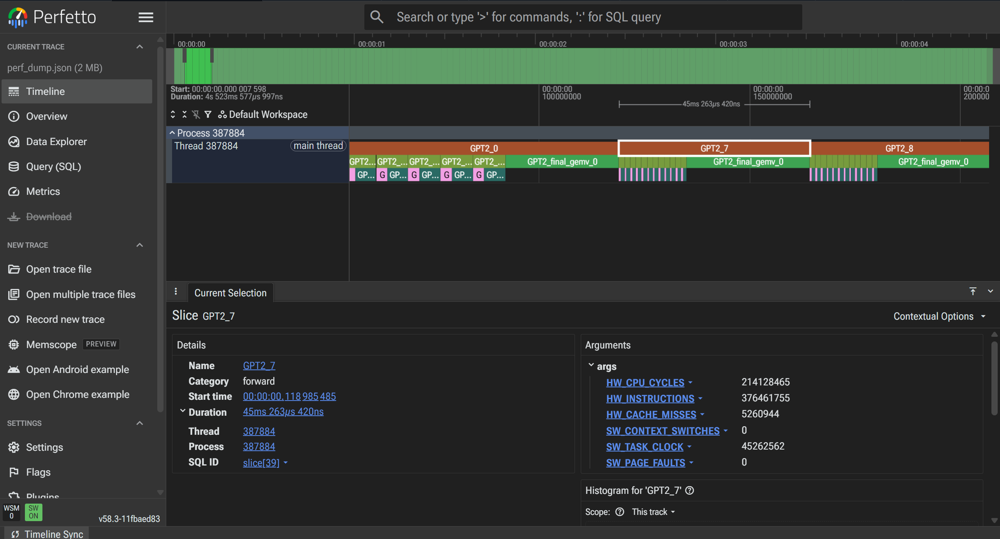

# gpt2.cpp
It is a toy! gpt2 inference is implemented in pure C++ without any dependency.

## download model

url: https://huggingface.co/openai-community/gpt2
weights for gpt2 can be downloaded from the following commands:
```bash
mkdir -p weights && cd weights
curl -L -o vocab.bpe    https://openaipublic.blob.core.windows.net/gpt-2/models/117M/vocab.bpe
curl -L -o encoder.json https://openaipublic.blob.core.windows.net/gpt-2/models/117M/encoder.json
## download model weights
curl -L -o config.json "https://huggingface.co/openai-community/gpt2/resolve/main/config.json?download=true"
curl -L -o model.safetensors "https://huggingface.co/openai-community/gpt2/resolve/main/model.safetensors?download=true"
cd ..
```
> If failed to download the model files, you can access the above urls and download them manually. Then copy them to `weights` directory.

## prepare
```bash
# turn on PMU for profiling
echo 0 | sudo tee /proc/sys/kernel/perf_event_paranoid
```

## run
```
# generate prompt weights_path (max-tokens temperature top-k seed)
./build/gpt2 generate "Hello World!" 
./build/gpt2 generate "Describe the iphone design" weights  100 0.8 40 42

# reference output:
Describe the iphone design from the previous page to the following page:

This design was commissioned to make the iPhone 5 as a personal device. It is not available for sale in any store. In addition, the iPhone 5 is not available for sale in any retail store.

I've always bought a phone that doesn't feature a screen, and it's very easy to use and simple to assemble. It takes about 5 minutes to assemble, and you can also use a pen or a flatbed to do the
```

## benchmark

turn on the env `export ENABLE_BENCHMARK=1`. Then the `first_token` and `next token` latency will be out.

## performance

> Intel(R) Core(TM) Ultra 7 155H

| version | first token(ms) | next token(ms) | first token speed up | next token speed up | comments |
| -- | -- | -- | -- | -- | -- |
| v0.0.1 | 1023 | 509 | x1 | x1 | baseline |
| v0.0.2 | 259 | 94 | x3.95 | x5.41 | update: kvcache [H,S,D] |
| v0.0.3 | 223 | 63 | x4.59 | x8.08 | update: element-wise avx2 |
| v0.0.4 | 115 | 43 | x8.9 | x11.84 | update: matmul avx2 |
| v0.0.5 | 102 | 24 | x10.0 | x20.2 | update: gemv IPL avx2 |

## profile

```bash
export LINUX_PERF=dump
```

then, profiled file will be dumpled in the current folder, named `perf_dump.json`. It can be read in `edge` or `chrome` browser.


